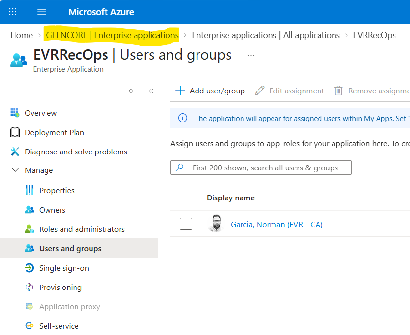

# Streamlit_SSO_Azure

Configured the SSO with Azure AD.

- Uses the streamlit[auth] python library in the requirements.txt file
- Create a .streamlit/secrets.toml with the following information:

`
[auth]
redirect_uri = "http://localhost:8501/oauth2callback"
cookie_secret = "LONG STRING OF CHARS"
client_id = "AZURE_APP_REGISTRATION_CLIENT_ID"
client_secret = "AZURE_APP_REGISTRATION_SECRET_VALUE"
server_metadata_url = "https://login.microsoftonline.com/<MY_TENANT_ID>/v2.0/.well-known/openid-configuration"
`

- In the Azure Enterprise applications, find the EVRRecOps and, under **Manage**,  go to **Users and Groups** and add the authorized users to use the app.

